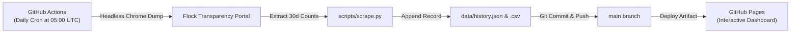

# Creedmoor NC PD — Flock Safety ALPR Rolling Statistics

[](https://github.com/WhatIsInCreedmoor/Flock-Rolling-Statistics/actions/workflows/daily-scrape.yml)
[](LICENSE)

A lightweight, automated historical time-series tracker for the [Creedmoor Police Department Flock Safety Transparency Portal](https://transparency.flocksafety.com/creedmoor-nc-pd).

Because Flock Safety only publishes **rolling 30-day cumulative sums** rather than an archive of daily counts, this project uses the **Git Scraping** pattern: an automated GitHub Action captures daily snapshots, archives them in Git, and renders an interactive time-series dashboard on GitHub Pages.

---

## 📊 Live Dashboard

👉 **[View the Live Dashboard](https://whatisincreedmoor.github.io/Flock-Rolling-Statistics/)** *(once GitHub Pages is enabled in repo settings)*

### Tracked Metrics:
1. **Vehicles Detected (30-Day Rolling):** Number of unique license plates scanned by Flock cameras across Creedmoor transit corridors.
2. **Officer Searches (30-Day Rolling):** Total investigative search queries conducted by officers in the ALPR system.
3. **Hotlist Hits (30-Day Rolling):** Automated alerts triggered against NCIC, Amber Alerts, and state hotlists.
4. **Active Cameras:** Fixed ALPR cameras deployed in Creedmoor (US-15, NC-56, W. Wilton Ave, S. Main St).

---

## 🛠️ Architecture



* **No server bills or databases:** 100% free and serverless on GitHub Actions + GitHub Pages.
* **Cloudflare-resistant:** Uses headless Google Chrome to execute JavaScript, navigate past Cloudflare bot protection, and dump the hydrated DOM for deterministic parsing.
* **Auditability:** Every single daily run is preserved as an immutable Git commit in the repository history.

---

## 📁 Repository Structure

```
.
├── .github/
│   └── workflows/
│       └── daily-scrape.yml    # Daily cron workflow & Pages deployer
├── data/
│   ├── latest.json             # Most recent single-day snapshot
│   ├── history.json            # Full historical time-series array (JSON)
│   └── history.csv             # Full historical time-series (CSV)
├── scripts/
│   └── scrape.py               # Headless scraper & data updater
├── index.html                  # Responsive dashboard UI
├── app.js                      # Chart.js time-series logic & simulation mode
├── style.css                   # Civic-tech dark UI styles
└── README.md
```

---

## 🚀 Setting Up GitHub Pages

To make the dashboard live on your GitHub account:

1. Open your repository on GitHub: `https://github.com/WhatIsInCreedmoor/Flock-Rolling-Statistics`
2. Go to **Settings** $\rightarrow$ **Pages** (in the left sidebar).
3. Under **Build and deployment**:
   * **Source**: Select **GitHub Actions**.
4. The `.github/workflows/daily-scrape.yml` workflow will automatically deploy the site on each run or commit.

---

## 💻 Local Development & Testing

### Prerequisites
* Python 3.8+
* Google Chrome or Chromium installed on your system

### 1. Test the Scraper Locally
```bash
# Clone the repository
git clone git@github.com:WhatIsInCreedmoor/Flock-Rolling-Statistics.git
cd Flock-Rolling-Statistics

# Run the scraper
python3 scripts/scrape.py
```
This updates `data/latest.json`, `data/history.json`, and `data/history.csv` with live data fetched directly from Creedmoor's portal.

### 2. View the Web Dashboard Locally
Start any static file server:
```bash
# Python built-in HTTP server
python3 -m http.server 8000
```
Open [http://localhost:8000](http://localhost:8000) in your browser.

---

## 📥 Data Export
For journalists, researchers, and public accountability audits, historical data can be downloaded directly:
* **JSON:** [`data/history.json`](data/history.json)
* **CSV:** [`data/history.csv`](data/history.csv)

---

## ⚖️ License
This project is open-source under the [MIT License](LICENSE). Data is mirrored from public records published by the Creedmoor Police Department on Flock Safety's public transparency portal.
